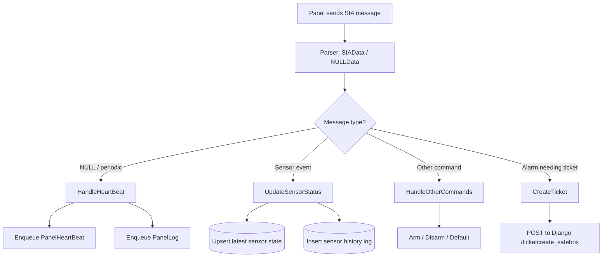
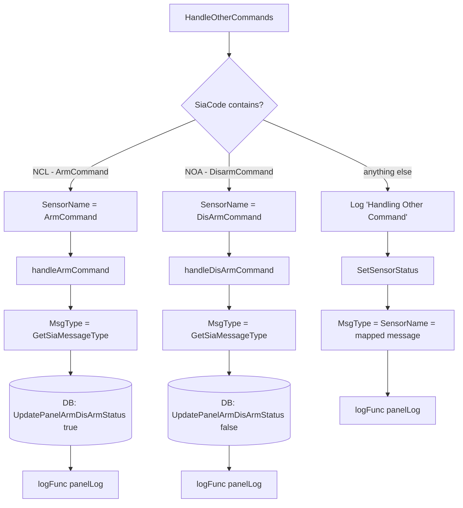
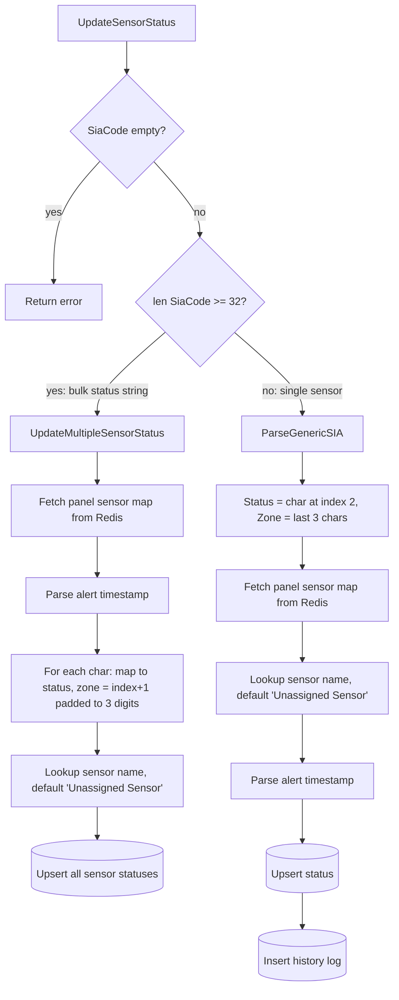
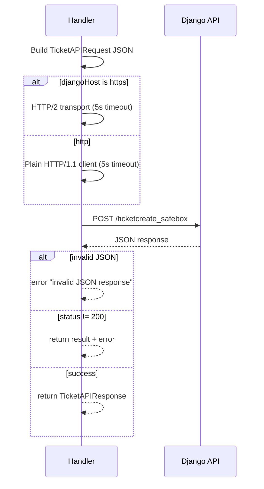

# Panel Handler (`package handler`)

Part of the `db-utopia` service. This package processes messages sent by **alarm/security panels** using the **SIA protocol**. It translates raw SIA event codes into human-readable messages, keeps the latest sensor state up to date, records history logs, tracks heartbeats, and raises tickets in an external Django service.

---

## Table of Contents

1. [Overview](#overview)
2. [Dependencies](#dependencies)
3. [Data Types](#data-types)
4. [SIA Code Reference](#sia-code-reference)
5. [Flow Diagrams](#flow-diagrams)
6. [Function Reference](#function-reference)
7. [Known Issues and Recommendations](#known-issues-and-recommendations)

---

## Overview

| Responsibility | Function(s) |
|---|---|
| Map an SIA code to a readable message | `GetSiaMessageType` |
| Route "other" (non-sensor) commands | `HandleOtherCommands` |
| Arm / Disarm panel state | `handleArmCommand`, `handleDisArmCommand` |
| Heartbeat (NULL / periodic report) | `HandleHeartBeat` |
| Sensor status from a command payload | `SetSensorStatus` |
| Sensor status from the SIA code itself | `UpdateSensorStatus`, `UpdateMultipleSensorStatus`, `ParseGenericSIA` |
| Create a ticket in the Django backend | `CreateTicket` |

---

## Dependencies

| Package | Purpose |
|---|---|
| `github.com/jackc/pgx/v5/pgxpool` | PostgreSQL connection pool |
| `golang.org/x/net/http2` | HTTP/2 transport for HTTPS ticket calls |
| `internal/constants` | Command constants (`ArmCommand`, `DisarmCommand`, `HeartBeat`) |
| `internal/db` | DB operations (upsert sensor status, insert logs, arm/disarm) |
| `internal/logger` | Logging (`Infof`, `Warnf`, `Errorf`) |
| `internal/models` | `PanelLog`, `PanelHeartBeat`, `TicketAPIRequest/Response` |
| `internal/parser` | `SIAData`, `NULLData`, `ZoneStatus` parsing |
| `internal/redis` | `PanelSensorCache` (panel to zone to sensor name map) |
| `internal/utils` | Shared helpers (IST timezone) |

---

## Data Types

```go
type EnqueueLogFunc func(models.PanelLog)              // async log writer
type EnqueueHeartBeatFunc func(models.PanelHeartBeat)  // async heartbeat writer

type PanelConfig struct {
    MacID, ClientID, PanelID, ReceiverID, IP, Port, Status string
}
```

`EnqueueLogFunc` and `EnqueueHeartBeatFunc` are injected callbacks, so handlers never write logs directly. They push them to a queue or worker.

---

## SIA Code Reference

### Sensor status codes (`sensorStatusMap`)

| Code | Status |
|---|---|
| `A` / `1` | `ALARM` |
| `R` / `0` | `RESTORE` |
| `U` / `2` | `UNINSTALLED` |
| `B` | `BYPASS` |

### Command types (`otherCommandTypeMap`)

| Category | Example codes |
|---|---|
| Heartbeat | `NULL` → Periodic Report |
| Arm / Disarm | `NCL` → ARM, `NOA` → DISARM, `NED400`, `NDA400`, `NSA400`, `NFA400`, `NNA400` |
| Authentication | `NBA558` (password login), `NWC` (wrong password), `NBA559` (utility login), `NBA560` (engineer login), `NCC` (password changed) |
| Hooter | `NBA561`, `NHA000`, `NFA501`, `NFA502` |
| Alerts | `NPA000` (panic), `NPA565` (PIR watchdog), `NBA555` (battery low) |
| Expander cards | `NEA701`–`NEA703` (disconnect), `NER701`–`NER703` (connect) |
| Housekeeping | `NBA553`, `NBA556`, `NBA557` (count clears), `NBA566` (keypad config) |
| Environment | `NYY651…` (temperature), `NYY652…` (light lux) |

---

## Flow Diagrams

### 1. High-level message handling



### 2. `HandleOtherCommands` routing



### 3. `GetSiaMessageType` resolution order

```mermaid
flowchart TD
    A[Input SIA code] --> B[TrimSpace]
    B --> C{Exact match in map?}
    C -->|yes| R1[Return mapped message]
    C -->|no| D{Code contains any map key?}
    D -->|yes| R1
    D -->|no| E[base = part before '|']
    E --> F{len base >= 6?}
    F -->|no| R4[UNKNOWN]
    F -->|yes| G[base = first 3 chars]
    G --> H{Ends with?}
    H -->|A| R2[ALARM]
    H -->|R| R3[ALARM RESTORAL]
    H -->|other| R4
```

### 4. Sensor status update (`UpdateSensorStatus`)



### 5. Ticket creation (`CreateTicket`)



---

## Function Reference

### `GetSiaMessageType(SIACode string) string`
Resolves an SIA code to a readable message in three steps:
1. **Exact match** in `otherCommandTypeMap`.
2. **Substring match**: the first key contained in the code.
3. **Fallback**: for codes of 6+ characters, the first 3 characters decide whether it is `ALARM` (ends in `A`) or `ALARM RESTORAL` (ends in `R`). Otherwise it returns `UNKNOWN`.

### `HandleOtherCommands(data, SiaCode, panelLogData, dbPool, logFunc, panelSensorCache)`
Entry point for non-heartbeat commands. Routes to arm, disarm, or the default branch (sensor status update, then log).

### `SetSensorStatus(dbPool, siaData, panelSensorCache)`
Used for commands that carry zone statuses in their payload.
1. Extracts zone statuses via `siaData.ExtractZoneStatuses()`.
2. Loads the panel's sensor map from Redis.
3. Parses the alert time (falls back to `time.Now()` in IST on error).
4. Enriches each zone with a sensor name and alert time.
5. **Upserts** the latest state and **inserts** a history log row.

### `HandleHeartBeat(data, panelLogData, logFunc, heartBeatFunc)`
Builds a `PanelHeartBeat` (panel ID, client ID, IP, source, receive time), then enqueues both the heartbeat and the panel log.

### `handleArmCommand` / `handleDisArmCommand`
Set `MsgType`, update the panel's armed state in the DB (`true` = armed, `false` = disarmed), and enqueue the log. DB errors are logged but do not stop the log from being enqueued.

### `ParseGenericSIA(siaCode string) (zone, status string, err error)`
For codes like `NBA001` / `NBR002`:
- Requires length >= 6.
- Status comes from index 2 (via `sensorStatusMap`).
- Zone is the last 3 characters.

### `UpdateSensorStatus(dbPool, siaData, panelSensorCache) error`
Updates sensor state from the SIA code itself. Codes of 32+ characters are treated as a bulk status string. Shorter codes are parsed as a single sensor event. Upserts the latest state and (for single events) inserts a history log.

### `UpdateMultipleSensorStatus(dbPool, siaData, panelSensorCache) error`
Treats each character of `SiaCode` as one zone's status, with the zone number equal to the character index plus 1 (`001`, `002`, …). Only the upsert runs. The history-log insert is currently commented out.

### `CreateTicket(data, SIACode, alerttime, djangoHost string) (*models.TicketAPIResponse, error)`
Sends a JSON `POST` to `{djangoHost}/ticketcreate_safebox` with `PanelID`, `SIACode`, `AlertTime` and `ClientID`. HTTPS uses an HTTP/2 transport and plain HTTP uses the default client, both with a 5-second timeout. Returns the decoded response, or an error on transport failure, invalid JSON, or a non-200 status.

---

## Known Issues and Recommendations

These are observations from reading the code, worth reviewing:

1. **`break` in `SetSensorStatus` enrichment loop.** When a zone is found in `panelMap`, `break` exits the loop before `SensorName` and `AlertTime` are assigned. Only the first matching zone is affected, and later zones are never enriched. It should be `sensorData[i].SensorName = val` with no `break`, and `AlertTime` should be set for every item.
2. **Non-deterministic substring match.** In `GetSiaMessageType`, step 2 iterates over a Go map, whose order is random. If several keys are contained in the code (e.g. `NBA56` variants), the result can differ between runs. Prefer longest-key-first matching.
3. **`HandleOtherCommands` uses exact lookup.** `otherCommandTypeMap[SiaCode]` is an exact match, so codes that only match via substring log an empty message in the default branch. Consider using `GetSiaMessageType(SiaCode)`.
4. **Inconsistent cache keys.** `UpdateSensorStatus` looks up `panelMap[siaCode]` (full code), while `UpdateMultipleSensorStatus` and `SetSensorStatus` use the zone. The single-sensor path probably wants `panelMap[zone]`.
5. **`InsecureSkipVerify: true`** in `CreateTicket` disables TLS certificate checks. Gate it behind a config flag or dev-only build, and use a real CA bundle in production.
6. **Ignored errors.** `json.Marshal` and `io.ReadAll` errors are discarded in `CreateTicket`. `handleDisArmCommand` also omits the error value in its log line.
7. **New client per call.** `CreateTicket` creates a new transport and client on every call, which prevents connection reuse. Create it once and reuse it.
8. **Map ordering in the bulk path.** `UpdateMultipleSensorStatus` iterates `siaData.SiaCode` by rune index. This is only correct for single-byte characters, so use byte indexing if the data is ASCII-only.
9. **Bulk history logging disabled.** Sensor history for bulk updates is not recorded (the insert is commented out). Confirm this is intentional.