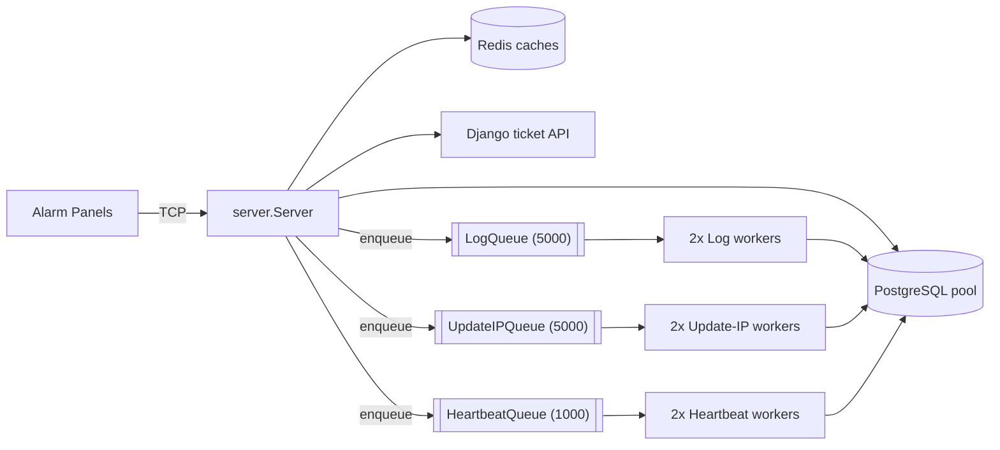
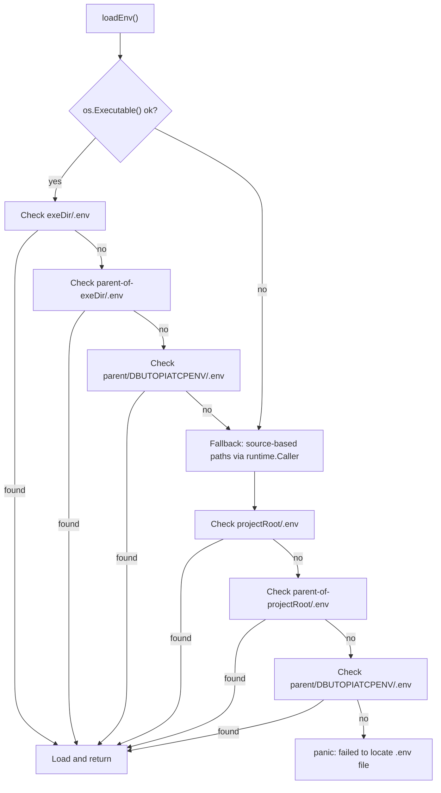
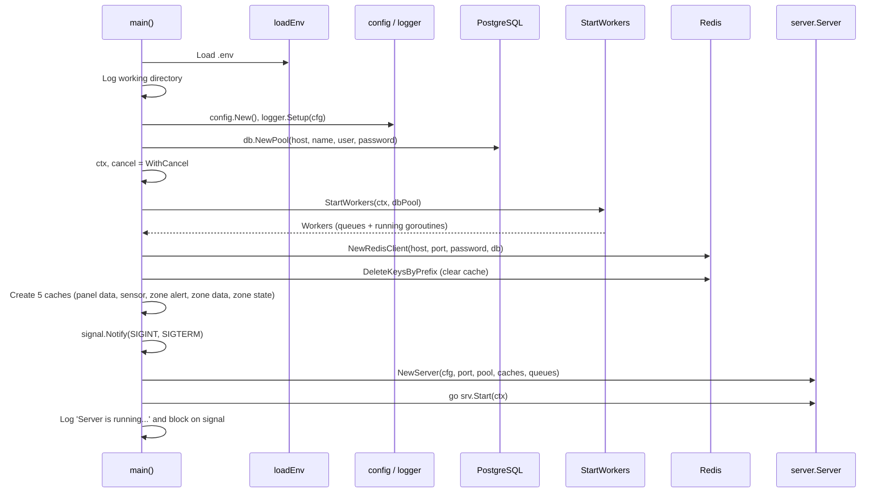
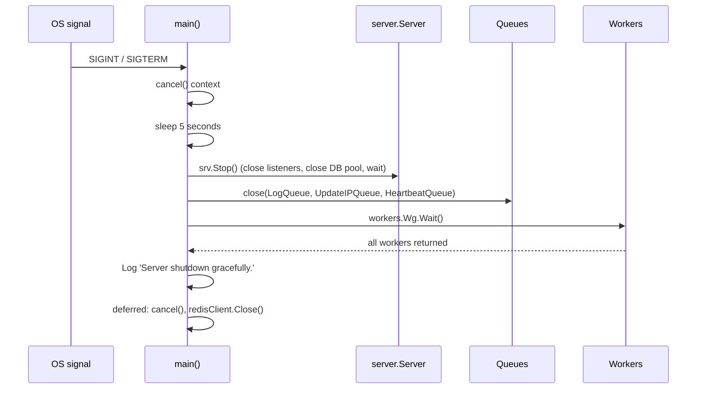

# Application Entry Point (`package main`)

Part of the `db-utopia` service. `main.go` is the **composition root**: it locates and loads the `.env` file, builds the configuration, logger, PostgreSQL pool and Redis caches, starts the background workers and the TCP server, and then coordinates a graceful shutdown on `Ctrl+C` / `SIGTERM`.

> Companion documents: `README_server.md` (TCP server), `README_parser.md` (SIA/NULL parser) and the `handler` README (business logic).

---

## Table of Contents

1. [Overview](#overview)
2. [Runtime Architecture](#runtime-architecture)
3. [Flow Diagrams](#flow-diagrams)
4. [Function and Type Reference](#function-and-type-reference)
5. [Configuration](#configuration)
6. [Running the Service](#running-the-service)
7. [Known Issues and Recommendations](#known-issues-and-recommendations)

---

## Overview

| Responsibility | Where |
|---|---|
| Locate and load the `.env` file | `loadEnv` |
| Build config, logger, DB pool, Redis client and caches | `main` |
| Create the three async queues and start worker goroutines | `StartWorkers`, `Workers` |
| Start the TCP server | `main` (`go srv.Start(ctx)`) |
| Handle shutdown signals and drain everything | `main` |

---

## Runtime Architecture



The queues are buffered channels. The server only pushes to them, and the workers (in the `worker` package) drain them and write to PostgreSQL.

---

## Flow Diagrams

### 1. `.env` discovery (`loadEnv`)



The first three paths target a **production binary** and the last three a **`go run` / development** setup. The first `.env` that exists and loads without error wins.

### 2. Startup sequence



### 3. Shutdown sequence



---

## Function and Type Reference

### `loadEnv()`
Searches for a `.env` file in up to six locations (three relative to the executable, three relative to the source file) and loads the first one found with `godotenv.Load`. It logs each path it checks, and **panics** if none is found.

### `main()`
1. `loadEnv()`, then logs the current working directory (`log.Fatalf` if it cannot be read).
2. `config.New()` and `logger.Setup(cfg)`.
3. `db.NewPool(...)` creates the PostgreSQL pool.
4. Creates a cancellable context and starts the workers.
5. Connects to Redis, schedules `Close()` with `defer`, and clears cached keys with `DeleteKeysByPrefix`.
6. Builds the caches: `PanelDataCache`, `PanelSensorCache` (1-hour TTL, backed by Redis and the DB pool), `ZoneAlertCache`, `PanelZoneDataCache`, `PanelZoneStateCache`.
7. Registers the signal channel for `os.Interrupt` and `SIGTERM`.
8. Creates the server and runs `srv.Start(ctx)` in a goroutine.
9. Blocks until a signal arrives, then runs the shutdown sequence.

### `type Workers`

| Field | Type | Purpose |
|---|---|---|
| `LogQueue` | `chan models.PanelLog` | Panel log records (buffer 5000) |
| `UpdateIPQueue` | `chan models.PanelIPUpdate` | Panel IP updates (buffer 5000) |
| `HeartbeatQueue` | `chan models.PanelHeartBeat` | Heartbeats (buffer 1000) |
| `Wg` | `sync.WaitGroup` | Waits for all workers to finish |

### `StartWorkers(ctx, dbPool) *Workers`
Creates the three queues and starts **2 workers per queue** (6 goroutines in total) using `worker.StartLogWorker`, `worker.StartUpdateIPWorker` and `worker.StartHeartbeatWorker`. Each is registered on the `WaitGroup` so `main` can wait for them. The worker count `n` is hard-coded to `2`.

---

## Configuration

`config.New()` reads values from the environment (populated by the `.env` file). The fields used in this file and in `server` are:

| Field | Used for |
|---|---|
| `DBHost`, `DBName`, `DBUser`, `DBPassword` | PostgreSQL connection |
| `RedisHost`, `RedisPort`, `RedisPassword`, `RedisDB` | Redis connection |
| `TcpHost`, `TcpPort` | TCP listener address for panels |
| `DjangoHost` | Base URL of the ticketing API |

The exact environment variable names are defined in the `config` package, which is not part of this file.

### `.env` search locations

| Mode | Search order |
|---|---|
| Production binary | `<exeDir>/.env`, then `<exeDir>/../.env`, then `<exeDir>/../DBUTOPIATCPENV/.env` |
| Development (`go run`) | `<projectRoot>/.env`, then `<projectRoot>/../.env`, then `<projectRoot>/../DBUTOPIATCPENV/.env` |

`projectRoot` is computed as two directory levels above `main.go` (so it assumes `main.go` lives one folder below the project root, such as `cmd/main.go`).

---

## Running the Service

```bash
# Development
go run ./cmd

# Production build
go build -o db-utopia-tcp ./cmd
./db-utopia-tcp
```

Adjust the package path to wherever `main.go` lives in your repo. Stop the service with `Ctrl+C` or `kill -TERM <pid>`. It will log `Received shutdown signal.` and shut down as described above.

---

## Known Issues and Recommendations

Observations from reading the code, worth reviewing:

1. **DB pool is closed before the workers drain the queues.** `srv.Stop()` calls `s.pool.Close()` (see `server.go`), and only afterwards does `main` close the queues and wait for the workers. Any records still buffered in the queues may then be written against a closed pool and be lost. Close the pool *after* `workers.Wg.Wait()` (for example `defer dbPool.Close()` in `main`, and remove it from `Server.Stop`).
2. **Possible "send on closed channel" panic.** The server spawns goroutines such as `go s.enqueueLog(...)`, `go s.enqueueUpdatePanel(...)` and `go handler.HandleHeartBeat(...)`. If one is still running when `main` closes the queues, it will panic, because sending on a closed channel panics even inside a `select` with `default`. The server also does not wait for its connection handlers. Track in-flight handlers with a WaitGroup and wait for them before closing the queues.
3. **Fixed `time.Sleep(5 * time.Second)`.** The shutdown always waits 5 seconds, regardless of how much work is pending, and may not be long enough under load. Prefer waiting on real completion signals.
4. **Worker ID closure bug.** In `StartWorkers`, the goroutines take an `id` parameter but use the loop variable `i` inside the body. On Go versions before 1.22, all workers may see the same (final) value of `i`. Use `id`.
5. **Workers use the cancellable `ctx`.** After `cancel()`, workers might exit immediately instead of draining their queues. Whether remaining items are processed depends on the `worker` package. Confirm that it drains until the channel is closed, or give workers a separate context.
6. **Redis cache is cleared on every start.** `DeleteKeysByPrefix` wipes cached data, including `ZoneAlertCache` counters, so the auto-bypass counts (more than 13 alerts) reset at each restart. Also, the success message `Redis cache cleared successfully` is logged **even if the call failed**, because it sits outside the error branch. Put the success log in an `else`.
7. **`.env` is mandatory.** `loadEnv` panics when no file is found, even if the variables are already set by Docker, systemd or Kubernetes. Consider making the file optional and validating required variables inside `config.New()`. Note that `godotenv.Load` does not override variables already present in the environment.
8. **Source-path fallback.** `runtime.Caller(0)` returns the path from build time. In a built binary run on another machine that path may not exist, so the fallback is only meaningful for `go run`. The `projectRoot` calculation also depends on the file's location in the repo.
9. **`log.Fatalf` skips deferred calls.** If `os.Getwd()` fails, `Fatalf` exits without running `cancel()` or `redisClient.Close()`. This is harmless this early, but worth knowing.
10. **Minor cleanups.** The variable `currnetPath` is misspelled. There is a leftover `// TODO: Start the server` even though the server is already started. A second `Ctrl+C` during shutdown is not handled specially. `main` mixes the standard `log` package with the project `logger`.