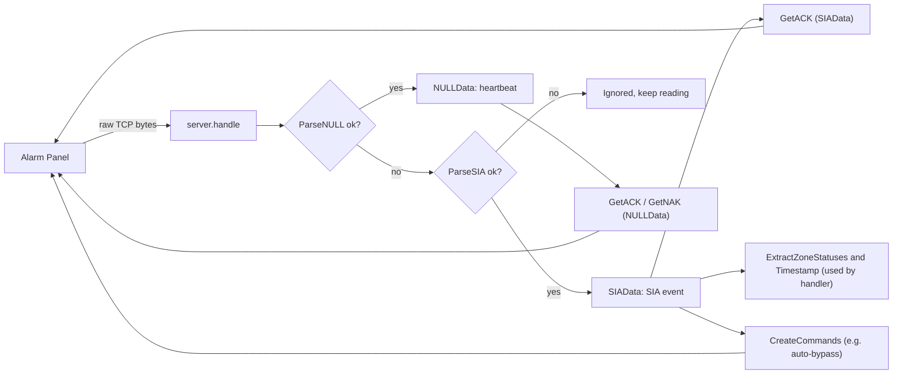
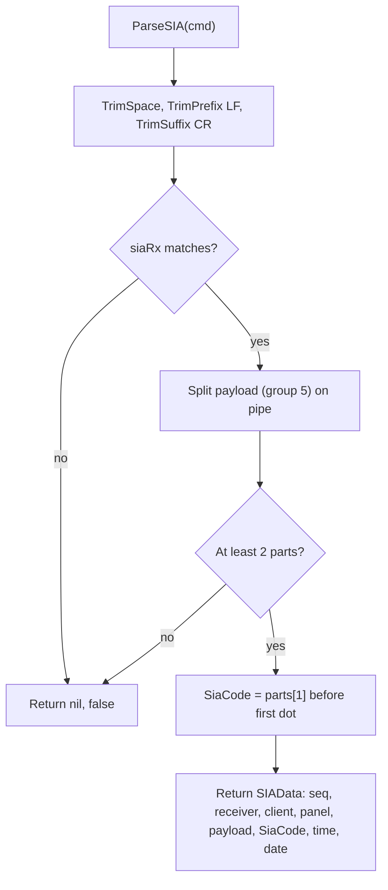
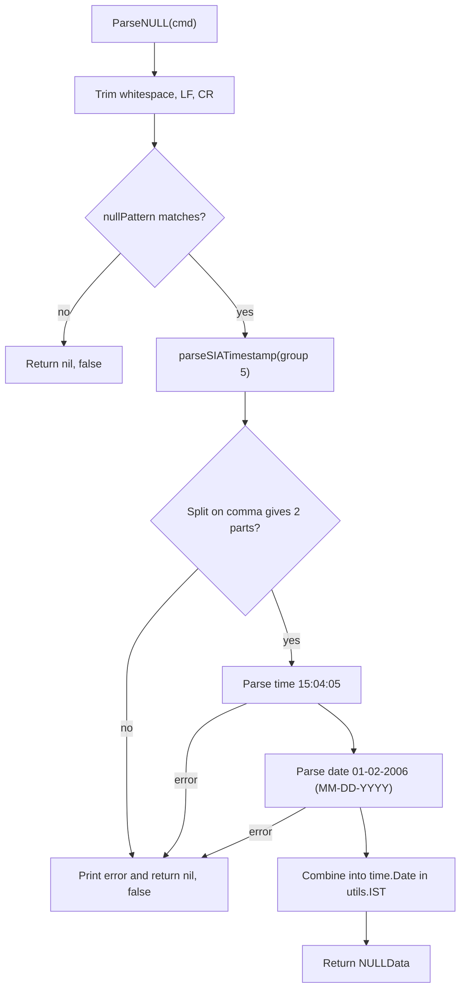
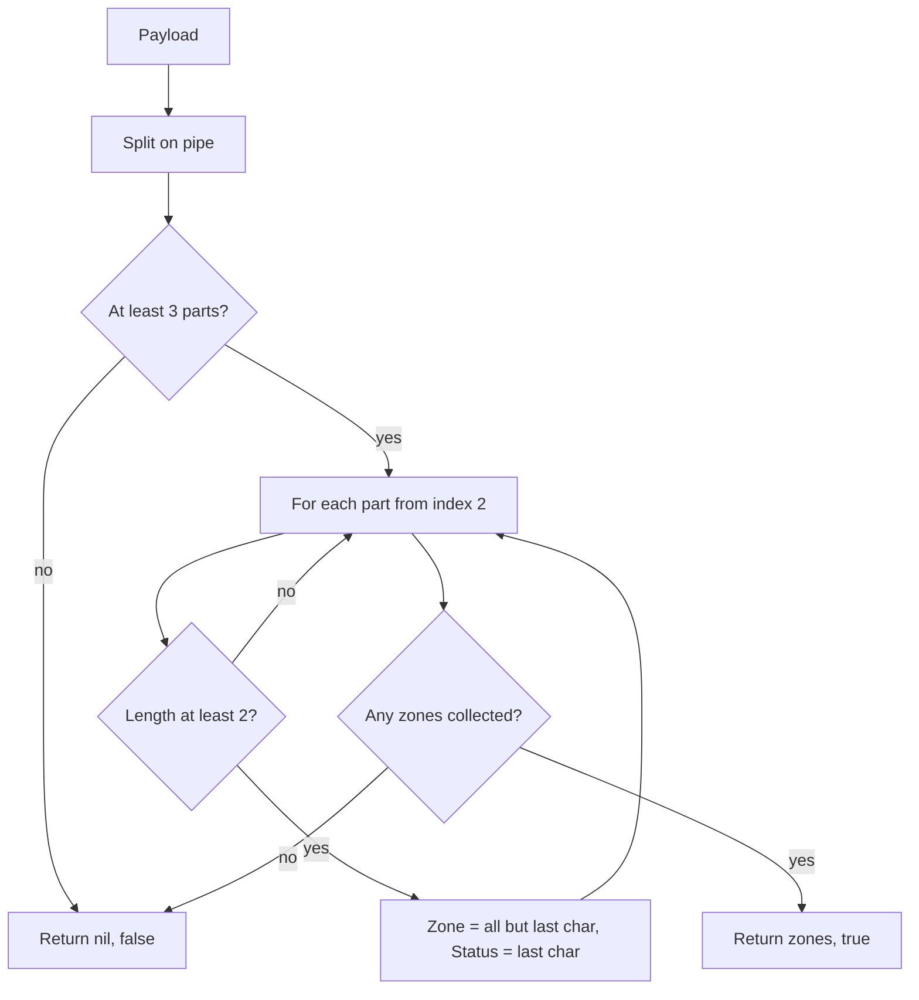
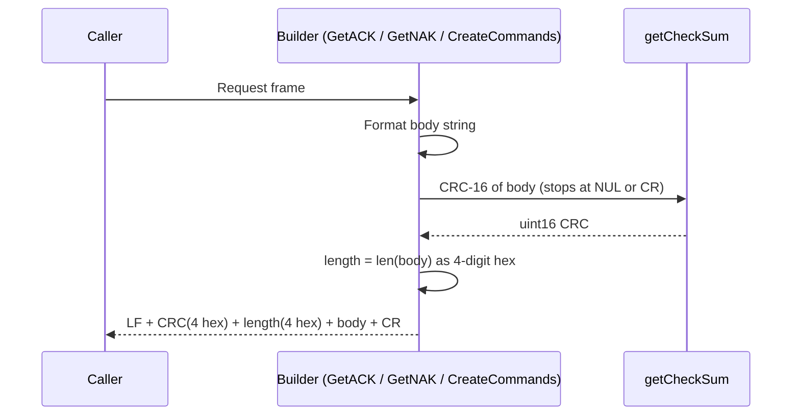

# SIA / NULL Message Parser (`package parser`)

Part of the `db-utopia` service. This package is the **protocol layer** between alarm/security panels and the rest of the application. It:

- parses incoming **SIA-DCS** event messages and **NULL** (heartbeat) messages into Go structs,
- extracts per-zone sensor statuses from a message payload,
- converts the panel's timestamp strings into `time.Time` (IST),
- builds outgoing frames (**ACK**, **NAK**, and **panel commands**) with the CRC-16 checksum and length header the panel expects.

> Companion documents: `README_server.md` (TCP server that calls this package) and the `handler` README (business logic that consumes the parsed data).

---

## Table of Contents

1. [Overview](#overview)
2. [Wire Format](#wire-format)
3. [Data Types](#data-types)
4. [Flow Diagrams](#flow-diagrams)
5. [Function Reference](#function-reference)
6. [Where It Is Used](#where-it-is-used)
7. [Known Issues and Recommendations](#known-issues-and-recommendations)

---

## Overview

| Responsibility | Function(s) |
|---|---|
| Parse an SIA-DCS event | `ParseSIA` |
| Parse a NULL heartbeat | `ParseNULL` |
| Extract zone/status pairs from a payload | `(*SIAData).ExtractZoneStatuses` |
| Convert panel timestamps to `time.Time` | `(*SIAData).Timestamp`, `parseSIATimestamp` |
| Build ACK / NAK replies | `(*SIAData).GetACK`, `(*SIAData).GetNAK`, `(*NULLData).GetACK`, `(*NULLData).GetNAK` |
| Build a command to send *to* the panel | `CreateCommands` |
| Checksum helpers | `GetChecksum`, `getCheckSum`, `calculateCRC` |

---

## Wire Format

Every frame (in both directions) has the same envelope:

| Part | Size | Description |
|---|---|---|
| Start | 1 byte | `0x0A` (LF) |
| CRC | 4 hex chars | CRC-16 of the **body** (uppercase hex, zero padded) |
| Length | 4 hex chars | Length of the **body** in bytes (uppercase hex) |
| Body | variable | Message text (see below) |
| End | 1 byte | `0x0D` (CR) |

### Body of an SIA-DCS event (incoming)

```
"SIA-DCS"<seq:4>R<receiver:6>L<client:6>#<panelID>[<payload>]_<HH:MM:SS>,<MM-DD-YYYY>
```

The payload is pipe-separated: `#<panelID>|<SIA code>[|<zone+status>|<zone+status>...]`

Illustrative example (made-up values):

```
"SIA-DCS"0012R000001L000123#PNL001[#PNL001|NBA001]_14:05:09,10-16-2026
```

### Body of a NULL heartbeat (incoming)

```
"NULL"<seq:4>R<receiver:6>L<client:6>#<panelID>[]_<HH:MM:SS>,<MM-DD-YYYY>
```

### Bodies of replies and commands (outgoing)

| Message | Body |
|---|---|
| ACK | `"ACK"<seq>R<receiver>L<client>#<panelID>[]` |
| NAK | `"NAK"<seq>R<receiver>L<client>#<panelID>[]_<HH:MM:SS,MM-DD-YYYY>` |
| Command | `"SIA-DCS"0001R<receiver>L<client>#<panelID>[#<panelID>\|<siaCode>]_<HH:MM:SS,DD-MM-YYYY>` |

---

## Data Types

### `SIAData`

| Field | Source |
|---|---|
| `Raw` | Trimmed original message |
| `SeqNo` | 4-digit sequence number |
| `Receiver` | 6-digit receiver ID (after `R`) |
| `ClientID` | 6-digit client ID (after `L`) |
| `PanelID` | Alphanumeric panel ID (after `#`) |
| `Payload` | Everything between `[` and `]` |
| `SiaCode` | Second pipe-separated part of the payload, with any `.suffix` removed |
| `TimeStr` / `DateStr` | Raw `HH:MM:SS` and `MM-DD-YYYY` strings |
| `PanelIP` | Set by the caller (server) |
| `PanelPK` | Set by the caller (server) after the DB/cache lookup |

### `NULLData`

`SeqNo`, `Receiver`, `ClientID`, `PanelID`, `Timestamp` (already a `time.Time` in IST), and `PanelIP` (set by the caller).

### `ZoneStatus`

`Zone`, `Status`, `SensorName`, `AlertTime`. The parser fills `Zone` and `Status`. The handler fills `SensorName` and `AlertTime` later.

---

## Flow Diagrams

### 1. Overall role in the pipeline



### 2. `ParseSIA`



### 3. `ParseNULL` and timestamp parsing



### 4. `ExtractZoneStatuses`



### 5. Building an outgoing frame



---

## Function Reference

### `ParseSIA(cmd string) (*SIAData, bool)`
Trims the message and matches it against `siaRx`. On success, returns an `SIAData` with all header fields, the raw payload, and the SIA code (second pipe-separated segment, cut at the first `.`). Returns `false` if the pattern does not match or the payload has fewer than two segments.

### `ParseNULL(cmd string) (*NULLData, bool)`
Same idea for heartbeats, using `nullPattern`. Also converts the embedded `HH:MM:SS,MM-DD-YYYY` timestamp into an IST `time.Time`. Returns `false` on any parse failure (and prints the error with `fmt.Printf`).

### `(*SIAData).ExtractZoneStatuses() ([]ZoneStatus, bool)`
Used for messages whose payload is `#panel|SIAcode|zoneStatus|zoneStatus...`. For each segment from the third onward (at least 2 characters), the last character becomes `Status` and the rest becomes `Zone`. For example, `001A` gives zone `001`, status `A`. Returns `false` if nothing usable is found.

### `(*SIAData).Timestamp() (time.Time, error)`
Parses `TimeStr` (`15:04:05`) and `DateStr` (`01-02-2006`, month first) and builds a `time.Time` in `Asia/Kolkata`.

### `parseSIATimestamp(tsStr string) (time.Time, error)`
Splits `time,date`, parses both, and returns a time in `utils.IST`. Used only by `ParseNULL`.

### `GetACK()` (on `SIAData` and `NULLData`)
Builds the acknowledgement frame. Both versions produce the same body format.

### `GetNAK()` (on `SIAData` and `NULLData`)
Builds a negative acknowledgement that includes the **current server time**. The server sends it for heartbeats whose timestamp differs from the server clock by more than 3 minutes, which tells the panel to resync its clock.

### `CreateCommands(siaCode string, data *SIAData) string`
Builds a command frame to send to a panel, for example the auto-bypass command `DCS033|W|<zone>|0`. It reuses the receiver, client ID and panel ID from the incoming `SIAData`, with a fixed sequence number `0001`.

### `GetChecksum(command string) string`
Returns `CRC(4 hex) + Length(4 hex)` for a given string. Exported helper, not used by the ACK/NAK builders in this file (they inline the same logic).

### `getCheckSum(data string) uint16` / `calculateCRC(crc, charPos uint16) uint16`
Bitwise CRC-16 using the reflected polynomial `0xA001` with an initial value of `0`. Processing stops at the first NUL (`0`) or CR (`13`) character. The source comment calls it a "Modbus variant", but Modbus normally starts at `0xFFFF`, so this behaves like CRC-16/ARC.

---

## Where It Is Used

| Caller | Functions used |
|---|---|
| `server.handle` | `ParseNULL`, `ParseSIA`, `(*NULLData).GetACK/GetNAK`, `(*SIAData).GetACK`, `CreateCommands` |
| `handler` package | `SIAData`, `ZoneStatus`, `ExtractZoneStatuses`, `Timestamp`, `NULLData` |

---

## Known Issues and Recommendations

Observations from reading the code, worth reviewing:

1. **Incoming CRC and length are not verified.** The CRC and length prefix were removed from `siaRx` (the lines are commented out), so any corrupted frame that still matches the pattern is accepted. Also, because the regex has no leading `^`, junk before `"SIA-DCS"` is silently ignored. Consider re-enabling validation, or at least anchoring the start.
2. **Inconsistent date formats.** Incoming timestamps and NAK replies use `MM-DD-YYYY`, but `CreateCommands` formats the time as `15:04:05,02-01-2006` (`DD-MM-YYYY`). Confirm which one the panel firmware expects for commands. One of them is probably wrong.
3. **`Timestamp()` can panic.** `time.LoadLocation("Asia/Kolkata")` ignores its error. If tzdata is missing (common in minimal containers), `loc` is `nil` and `time.Date` panics. It also reloads the zone on every call. Use `utils.IST`, as `parseSIATimestamp` does.
4. **NAK and command times use the server's local zone.** `GetNAK` and `CreateCommands` call `time.Now()` without converting to IST, so the output depends on the server's time zone.
5. **Stale comment in `parseSIATimestamp`.** It says "try both formats" but only `01-02-2006` is tried.
6. **Duplicate frame-building code.** `GetACK`/`GetNAK` on both types, `CreateCommands`, and `GetChecksum` repeat the same CRC/length/envelope logic. A single helper such as `buildFrame(body string) string` would remove the duplication and keep the formats consistent.
7. **CRC iterates runes, length counts bytes.** `getCheckSum` uses `for _, c := range data` (runes), while the length uses `len(body)` (bytes). They only agree for ASCII, so iterate over bytes to be safe.
8. **Misleading CRC comment.** The code uses initial value `0`, not the Modbus `0xFFFF` (see above). Update the comment, or the algorithm if the panel really needs Modbus.
9. **`fmt.Printf` for errors.** `ParseNULL` prints parse errors to stdout. Use the project `logger` instead (or return the error).
10. **Hard-coded sequence number.** `CreateCommands` always sends `0001`. If the panel tracks sequence numbers, repeated commands may be treated as duplicates.
11. **Raw status characters.** `ExtractZoneStatuses` returns the raw last character (`A`, `R`, `1`, `0`, …) with no validation. The handler's `SetSensorStatus` stores it as-is, whereas `UpdateSensorStatus` maps it to `ALARM`/`RESTORE` through `sensorStatusMap`, so the two paths can store different representations.
12. **Single-frame assumption.** `ParseSIA` and `ParseNULL` expect exactly one frame per read. If two frames arrive in one TCP read, or one is split across reads, the `$`-anchored regex will fail or mis-match. Buffering by the `0x0A`...`0x0D` delimiters would be more robust.
13. **Redundant trimming.** `strings.TrimSpace` already removes `\n` and `\r`, so the following `TrimPrefix`/`TrimSuffix` calls do nothing.