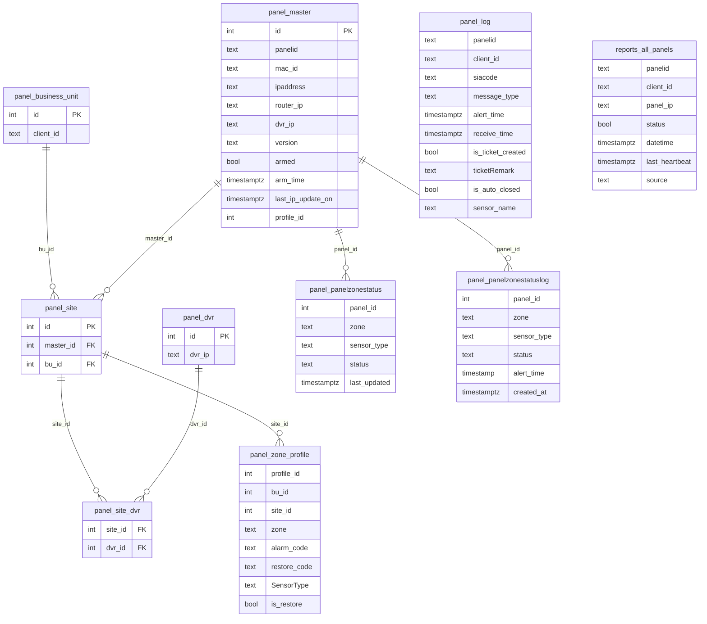
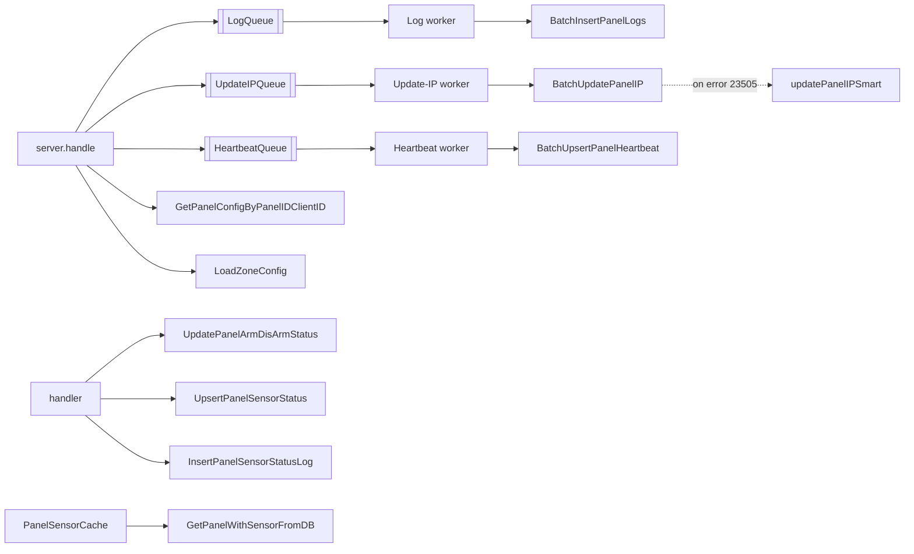
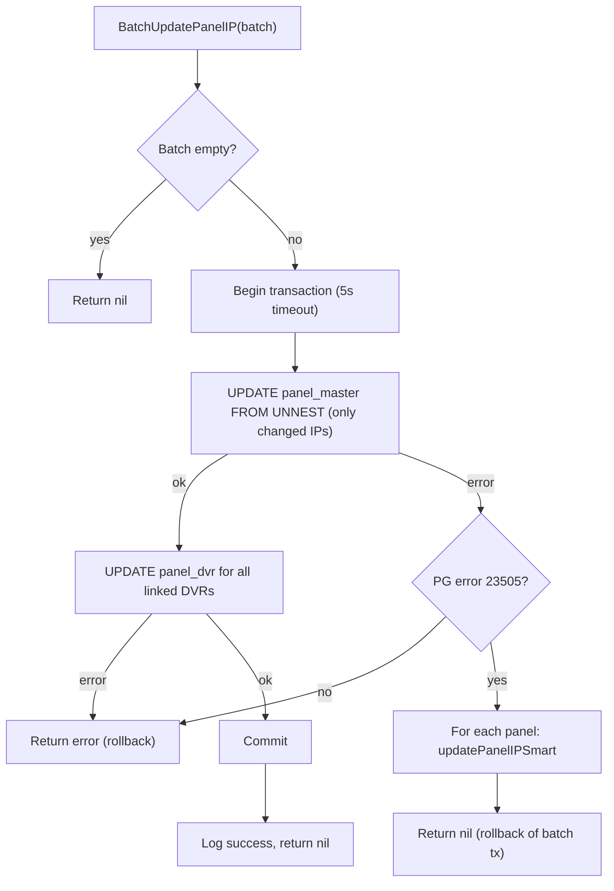
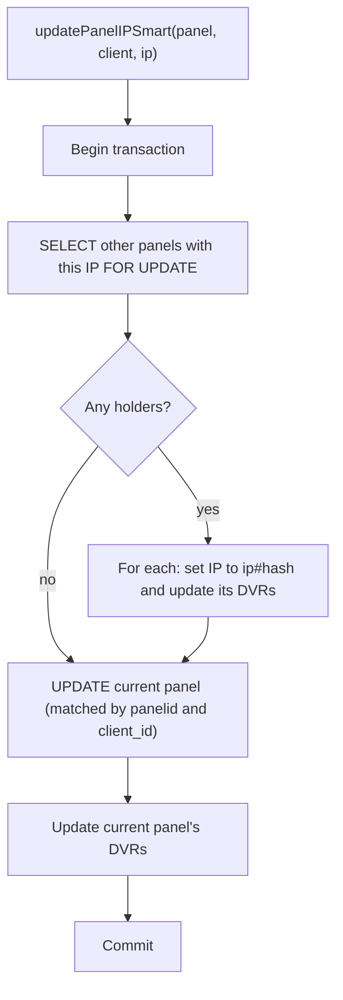
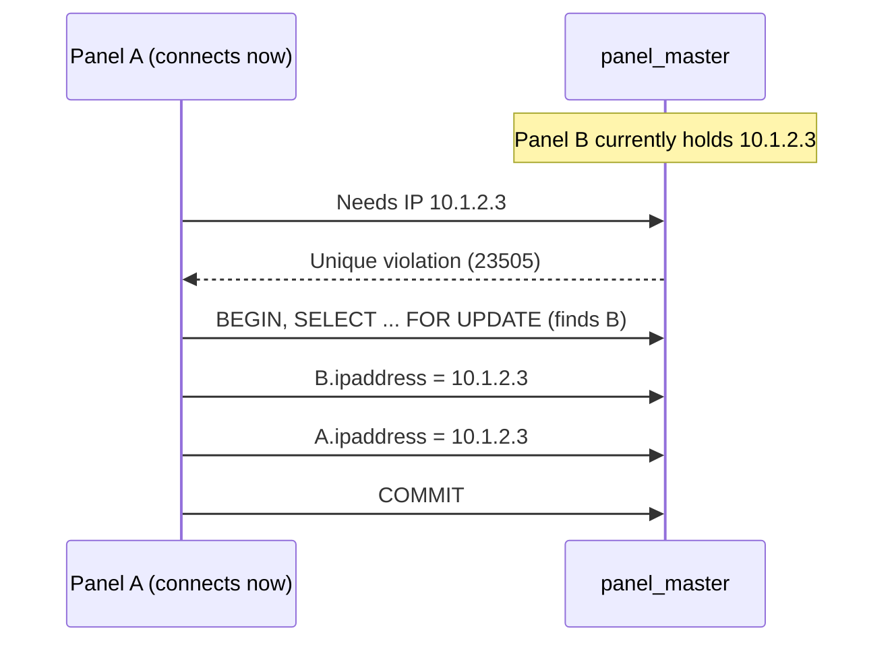

# Database Layer (`package db`)

Part of the `db-utopia` service. This package contains **every SQL query** the TCP service runs against PostgreSQL (through a `pgxpool.Pool`). It covers three areas:

- **Writes** driven by panel traffic: logs, IP changes, heartbeats, arm/disarm state, and sensor/zone status.
- **Lookups** that resolve a panel's identity and primary key.
- **Configuration loads** used to fill Redis caches (sensor names and zone alarm/restore codes).

> Companion documents: `README_main.md`, `README_server.md`, `README_parser.md` and the `handler` README.

---

## Table of Contents

1. [Overview](#overview)
2. [Tables and Relationships](#tables-and-relationships)
3. [SQL Patterns Used](#sql-patterns-used)
4. [Query Summary](#query-summary)
5. [Query-by-Query Explanation](#query-by-query-explanation)
6. [Flow Diagrams](#flow-diagrams)
7. [Required Indexes and Constraints](#required-indexes-and-constraints)
8. [Known Issues and Recommendations](#known-issues-and-recommendations)

---

## Overview

| Area | Functions |
|---|---|
| Batched writes (called by queue workers) | `BatchInsertPanelLogs`, `BatchUpdatePanelIP`, `BatchUpsertPanelHeartbeat` |
| IP conflict resolution | `updatePanelIPSmart`, `updatePanelDVRIPs`, `shortHash` |
| Panel lookups | `GetPanelConfigByPanelID`, `GetPanelConfigByPanelIDClientID`, `GetPanelConfigByMacID` |
| Single-panel updates | `SetPanelIpAndVersion`, `UpdatePanelArmDisArmStatus` |
| Sensor/zone status | `UpsertPanelSensorStatus`, `InsertPanelSensorStatusLog` |
| Cache source data | `GetPanelWithSensorFromDB`, `LoadZoneConfig` |

---

## Tables and Relationships

The tables below are **inferred from the joins** in the queries. Check them against your actual schema.



`panel_log` and `reports_all_panels` are keyed by `panelid` / `client_id` text values rather than by foreign keys. The two zone-status tables use `panel_id`, which is the `panel_master.id` primary key (called `PanelPK` in Go).

---

## SQL Patterns Used

### 1. Batch writes with `UNNEST`
Instead of one `INSERT` per row, Go builds one array per column and sends them as parameters:

```sql
INSERT INTO t (a, b)
SELECT * FROM UNNEST($1::text[], $2::int[]);
```

`UNNEST` with several arrays zips them **by position** into rows (`$1[1]` with `$2[1]`, and so on). A batch of 500 rows becomes **one statement and one round trip**. Because the match is positional, **the order of arrays must match the order of columns** (it does in all queries below).

### 2. Update from a list: `UPDATE ... FROM UNNEST(...)`
The arrays are turned into a temporary row set and joined to the table being updated, so many rows are changed in one statement.

### 3. Upsert: `INSERT ... ON CONFLICT ... DO UPDATE`
Insert a row, or update it if a row with the same unique key already exists. This needs a **unique constraint** on the conflict columns (see [Required Indexes](#required-indexes-and-constraints)).

### 4. `IS DISTINCT FROM`
A NULL-safe "not equal". It is used so a row is only written when the value actually changes, which avoids needless writes and lock contention.

### 5. Transactions and `FOR UPDATE`
Multi-step updates run inside a transaction (`Begin`, `Exec`s, `Commit`, with `defer Rollback`). `SELECT ... FOR UPDATE` locks the selected rows until commit so concurrent updates cannot interleave.

### 6. Timeouts
Every call has a `context.WithTimeout` (1 to 5 seconds) so a slow database cannot hang a worker or connection goroutine forever.

---

## Query Summary

| Function | Type | Main table(s) | Timeout |
|---|---|---|---|
| `BatchInsertPanelLogs` | Batch `INSERT` | `panel_log` | 5s |
| `BatchUpdatePanelIP` | Batch `UPDATE` (+ DVR update), transaction | `panel_master`, `panel_dvr` | 5s |
| `updatePanelIPSmart` | `SELECT FOR UPDATE` + `UPDATE`s, transaction | `panel_master`, `panel_dvr` | 5s |
| `updatePanelDVRIPs` | `UPDATE` (inside a transaction) | `panel_dvr` | caller's |
| `BatchUpsertPanelHeartbeat` | Batch upsert | `reports_all_panels` | 5s |
| `GetPanelConfigByPanelID` | `SELECT` (one row) | `panel_master`, `panel_site`, `panel_business_unit` | 5s |
| `GetPanelConfigByPanelIDClientID` | `SELECT` (one row) | same | 5s |
| `GetPanelConfigByMacID` | `SELECT` (one row) | same | 5s |
| `SetPanelIpAndVersion` | Two `UPDATE`s, transaction | `panel_master`, `panel_dvr` | 2s |
| `UpdatePanelArmDisArmStatus` | `UPDATE` | `panel_master` | 1s |
| `UpsertPanelSensorStatus` | Batch upsert | `panel_panelzonestatus` | 5s |
| `InsertPanelSensorStatusLog` | Batch `INSERT` | `panel_panelzonestatuslog` | 5s |
| `GetPanelWithSensorFromDB` | `SELECT` (many rows) | `panel_master`, `panel_site`, `panel_zone_profile` | caller's |
| `LoadZoneConfig` | `SELECT` (many rows) | `panel_zone_profile`, `panel_site`, `panel_business_unit`, `panel_master` | caller's |

---

## Query-by-Query Explanation

### 1. `BatchInsertPanelLogs(ctx, dbPool, []models.PanelLog)`

**Purpose:** Store a batch of panel log records (every message received or sent) in `panel_log`.

**How it works**
1. Splits the slice of `PanelLog` structs into 17 parallel arrays, one per column.
2. If `SensorName` is empty it is stored as the literal text `Invalid Sensor`.
3. Runs a single `INSERT INTO panel_log (...) SELECT * FROM UNNEST(17 arrays)`.

**Details**
- Timestamps use `timestamptz[]`, booleans use `boolean[]`, everything else `text[]`.
- The column `"ticketRemark"` is quoted because it is mixed-case. Without quotes PostgreSQL would fold it to `ticketremark`.
- It is **one statement**, so the batch is atomic: if one row is invalid, the whole batch fails and none is inserted.
- `PanelPK` from the model is **not** stored. The table is keyed by `panelid` and `client_id`.
- On error it logs the batch size and the first panel ID as a sample.

---

### 2. `BatchUpdatePanelIP(ctx, dbPool, []models.PanelIPUpdate)`

**Purpose:** Record the latest IP address of many panels in one go. It is the batch version of "this panel just connected from IP X".

**Step 1 - Update `panel_master`** (inside a transaction)

```sql
UPDATE panel_master pm
SET ipaddress = data.panel_ip,
    router_ip = data.panel_ip,
    dvr_ip    = data.panel_ip,
    last_ip_update_on = NOW()
FROM UNNEST($1::varchar[], $2::varchar[], $3::varchar[])
       AS data(panelid, client_id, panel_ip),
     panel_site ps,
     panel_business_unit pbu
WHERE pm.panelid = data.panelid
  AND ps.master_id = pm.id
  AND pbu.id = ps.bu_id
  AND pbu.client_id = data.client_id
  AND pm.ipaddress IS DISTINCT FROM data.panel_ip
```

- `UNNEST` builds a virtual table `data(panelid, client_id, panel_ip)` from the three arrays.
- The joins to `panel_site` and `panel_business_unit` make sure the **panel ID belongs to the stated client**, so a panel ID reused by another client is not touched.
- `IS DISTINCT FROM` skips panels whose IP did not change.
- The same IP is written to `ipaddress`, `router_ip` and `dvr_ip`.

**Step 2 - Unique-violation fallback**
If the update fails with PostgreSQL error `23505` (unique violation), another panel already holds that IP and the column is unique. The function then logs a warning and calls `updatePanelIPSmart` for **each** panel in the batch, one by one (see below), and returns `nil`. Any other error is returned as is.

**Step 3 - Update `panel_dvr`**

```sql
UPDATE panel_dvr pd
SET dvr_ip = data.panel_ip
FROM (
    SELECT DISTINCT psd.dvr_id, u.panel_ip
    FROM UNNEST(...) AS u(panelid, client_id, panel_ip)
    JOIN panel_master pm ON pm.panelid = u.panelid
    JOIN panel_site ps ON ps.master_id = pm.id
    JOIN panel_site_dvr psd ON psd.site_id = ps.id
    JOIN panel_business_unit pbu ON pbu.id = ps.bu_id AND pbu.client_id = u.client_id
) data
WHERE pd.id = data.dvr_id
```

This finds every DVR attached to each panel's site (via `panel_site_dvr`) and sets its IP to the panel's IP, so DVRs behind the same router follow the panel. Then the transaction is committed and the success is logged.

---

### 3. `updatePanelIPSmart(ctx, dbPool, panelID, clientID, ip)`

**Purpose:** Safely give a panel an IP address that is **already assigned to another panel**, without violating the unique constraint.

Inside one transaction:

1. **Find the current holders and lock them**
   ```sql
   SELECT panelid FROM panel_master
   WHERE ipaddress = $1 AND panelid != $2
   FOR UPDATE
   ```
2. **Move each old holder aside.** Each one gets a unique "parked" IP in the form `<ip>#<3-hex-hash>` (for example `10.1.2.3#a4f`). Its `ipaddress`, `router_ip` and `dvr_ip` are changed, and then `updatePanelDVRIPs` updates its DVRs too.
3. **Assign the IP to the current panel** (filtered by `panelid` and `client_id` through the site/business-unit joins), set `last_ip_update_on = NOW()`, and update its DVRs.
4. **Commit.**

The idea is that the panel that most recently connected from an IP is the one that owns it. Any previous owner is parked on a placeholder value.

**Helpers**
- `shortHash(panelID)`: FNV-32a hash of the panel ID, modulo 4096, formatted as 3 hex characters. It makes the parked IP deterministic and mostly unique.
- `updatePanelDVRIPs(ctx, tx, panelID, ip)`:
  ```sql
  UPDATE panel_dvr pd SET dvr_ip = $1
  FROM panel_master pm
  JOIN panel_site ps ON ps.master_id = pm.id
  JOIN panel_site_dvr psd ON psd.site_id = ps.id
  WHERE pm.panelid = $2 AND pd.id = psd.dvr_id
  ```
  Sets `dvr_ip` on all DVRs linked to the panel through its sites.

---

### 4. `BatchUpsertPanelHeartbeat(ctx, dbPool, []models.PanelHeartBeat)`

**Purpose:** Keep one "last seen" row per panel in `reports_all_panels`.

**How it works**
1. **De-duplicates in Go** by `panelid|client_id`, keeping the entry with the latest `ReceiveTime`. This is required: PostgreSQL raises *"ON CONFLICT DO UPDATE command cannot affect row a second time"* if the same key appears twice in one statement.
2. Builds arrays and runs:

```sql
INSERT INTO reports_all_panels
  (panelid, client_id, panel_ip, status, datetime, source, last_heartbeat)
SELECT ... FROM UNNEST(7 arrays) AS t(...)
ON CONFLICT (panelid, client_id)
DO UPDATE SET panel_ip = EXCLUDED.panel_ip,
              status = EXCLUDED.status,
              datetime = EXCLUDED.datetime,
              source = EXCLUDED.source,
              last_heartbeat = EXCLUDED.last_heartbeat
```

**Details**
- `status` is always `true` (the panel is alive because it just sent a heartbeat).
- `datetime` and `last_heartbeat` both get the receive time (the same array is passed as `$5` and `$7`).
- The log line reports `RowsAffected`, which counts both inserted and updated rows.

---

### 5. `GetPanelConfigByPanelID`, `GetPanelConfigByPanelIDClientID`, `GetPanelConfigByMacID`

**Purpose:** Resolve a panel's identity: primary key (`pm.id`), `panelid`, `mac_id` and `client_id`.

```sql
SELECT pm.id, pm.panelid, COALESCE(pm.mac_id, '') AS mac_id, pbu.client_id
FROM panel_master pm
JOIN panel_site ps ON ps.master_id = pm.id
JOIN panel_business_unit pbu ON pbu.id = ps.bu_id
WHERE <condition>
LIMIT 1
```

| Function | `WHERE` condition |
|---|---|
| `GetPanelConfigByPanelID` | `pm.panelid = $1` |
| `GetPanelConfigByPanelIDClientID` | `pm.panelid = $1 AND pbu.client_id = $2` |
| `GetPanelConfigByMacID` | `pm.mac_id = $1` |

- `COALESCE(mac_id, '')` turns a NULL MAC into an empty string so it scans into a Go `string`.
- When nothing matches, `QueryRow(...).Scan` returns `pgx.ErrNoRows`. Callers must handle this.
- `GetPanelConfigByPanelIDClientID` is the one the server uses (through the Redis `PanelDataCache`) to get `PanelPK` for each message.

---

### 6. `SetPanelIpAndVersion(dbPool, panelPK int64, panelIP, panelVersion)`

**Purpose:** Update a panel's IP **and firmware version** by primary key.

Inside one transaction (2-second timeout):
1. `UPDATE panel_master SET ipaddress=$1, router_ip=$1, dvr_ip=$1, version=$2 WHERE id=$3`
2. `UPDATE panel_dvr pd SET dvr_ip=$1 FROM panel_site ps JOIN panel_site_dvr psd ON psd.site_id = ps.id WHERE ps.master_id=$2 AND pd.id=psd.dvr_id`

Unlike the batch update, it does not set `last_ip_update_on`, and it has no unique-violation handling.

---

### 7. `UpdatePanelArmDisArmStatus(dbPool, panelPK, isArm)`

**Purpose:** Record that a panel was armed or disarmed.

```sql
UPDATE panel_master SET armed = $2, arm_time = NOW() WHERE id = $1
```

Called from the handler when an arm command (`NCL`) or disarm command (`NOA`) arrives. 1-second timeout. `arm_time` is refreshed on every call, even if the state is unchanged.

---

### 8. `UpsertPanelSensorStatus(dbPool, panelPK, []parser.ZoneStatus)`

**Purpose:** Maintain the **current** status of each zone/sensor of a panel in `panel_panelzonestatus`.

```sql
INSERT INTO panel_panelzonestatus (zone, sensor_type, status, last_updated, panel_id)
SELECT zone, sensor_type, status, NOW(), $1
FROM UNNEST($2::text[], $3::text[], $4::text[]) AS t(zone, status, sensor_type)
ON CONFLICT (panel_id, zone)
DO UPDATE SET status = EXCLUDED.status,
              sensor_type = EXCLUDED.sensor_type,
              last_updated = NOW()
WHERE panel_panelzonestatus.status IS DISTINCT FROM EXCLUDED.status
   OR panel_panelzonestatus.sensor_type IS DISTINCT FROM EXCLUDED.sensor_type
```

- `$1` is the panel primary key, applied to every row. `$2`, `$3`, `$4` are zones, statuses and sensor names.
- The `UNNEST` alias order `(zone, status, sensor_type)` matches the order the arrays are passed, which is why `sensor_type` comes last in the alias but is selected second.
- The `WHERE` on `DO UPDATE` means a row is rewritten **only if the status or sensor name changed**. So `last_updated` means "last time it *changed*", not "last time we heard from it". Repeated identical reports cause no write.
- The "sensor_type" column stores the sensor **name** (`SensorName`).

---

### 9. `InsertPanelSensorStatusLog(dbPool, panelID, []parser.ZoneStatus)`

**Purpose:** Append-only **history** of every zone status report, in `panel_panelzonestatuslog`.

```sql
INSERT INTO panel_panelzonestatuslog
  (zone, sensor_type, status, created_at, panel_id, alert_time)
SELECT zone, sensor_type, status, NOW(), $1, t.alert_time
FROM UNNEST($2::text[], $3::text[], $4::text[], $5::timestamp[])
     AS t(zone, status, sensor_type, alert_time)
```

- `created_at` is the server insert time, `alert_time` is the time the panel reported.
- Note that `alert_time` uses `timestamp[]` (no time zone), whereas `panel_log` uses `timestamptz[]`.
- Pairs with query 8: the upsert holds the latest state, this table holds the history.

---

### 10. `GetPanelWithSensorFromDB(ctx, db, panelPK)`

**Purpose:** Build a lookup map from codes to sensor types for one panel (the data behind the Redis `PanelSensorCache`).

```sql
SELECT pzp.alarm_code, pzp.restore_code, pzp."SensorType", pzp.zone
FROM panel_master p
JOIN panel_site s ON p.id = s.master_id
JOIN panel_zone_profile pzp
     ON pzp.profile_id = p.profile_id
    AND pzp.bu_id = s.bu_id
    AND pzp.site_id = s.id
WHERE p.id = $1
```

The three-way join on `profile_id`, `bu_id` and `site_id` picks only the zone profile rows that belong to **this panel's profile at this panel's site**.

For each row, Go fills one map with up to **three keys pointing at the same sensor type**:

| Key | Example |
|---|---|
| `alarm_code` | `NBA001` |
| `zone` | `001` |
| `restore_code` (if not empty) | `NBR001` |

That is why the handler code can look up a sensor name by either the full SIA code or the zone number.

---

### 11. `LoadZoneConfig(ctx, db, panelID, clientID)`

**Purpose:** Load each zone's alarm and restore SIA codes (used by `GetZoneConfig` and `ShouldCreateTicket` in the server).

```sql
SELECT pzp.zone, pzp.alarm_code, pzp.restore_code
FROM panel_zone_profile pzp
JOIN panel_site ps ON ps.id = pzp.site_id
JOIN panel_business_unit pbu ON pbu.id = ps.bu_id
JOIN panel_master pm ON pm.id = ps.master_id
WHERE pm.panelid = $1
  AND pbu.client_id = $2
  AND pzp.is_restore != true
```

Returns a `map[zone]ZoneConfig{Alarm, Restore}`. The filter `is_restore != true` excludes profile rows that describe restore events themselves, so only one row per zone remains.

---

## Flow Diagrams

### 1. Where each function is used



The worker to function links are inferred from the worker names, since the `worker` package is not shown.

### 2. `BatchUpdatePanelIP`



### 3. `updatePanelIPSmart`



### 4. Example of IP conflict resolution



---

## Required Indexes and Constraints

The upserts depend on these **unique constraints**. Without them `ON CONFLICT` fails at runtime.

| Table | Required unique key | Used by |
|---|---|---|
| `reports_all_panels` | `(panelid, client_id)` | `BatchUpsertPanelHeartbeat` |
| `panel_panelzonestatus` | `(panel_id, zone)` | `UpsertPanelSensorStatus` |
| `panel_master` | `ipaddress` (unique, which triggers the `23505` fallback) | `BatchUpdatePanelIP` |

Helpful (non-unique) indexes for the lookups:

| Table | Columns |
|---|---|
| `panel_master` | `panelid`, `mac_id`, `ipaddress` |
| `panel_site` | `master_id`, `bu_id` |
| `panel_business_unit` | `client_id` |
| `panel_site_dvr` | `site_id` |
| `panel_zone_profile` | `(profile_id, bu_id, site_id)`, `site_id` |

---

## Known Issues and Recommendations

Observations from reading the code, worth reviewing:

1. **`shortHash` hashes the wrong panel ID.** In `updatePanelIPSmart`, the parked IP uses `shortHash(panelID)` (the panel taking the IP) instead of `shortHash(pid)` (the panel being moved). If two panels hold the same IP, both get the same parked value and may violate the unique constraint again. Use `shortHash(pid)`.
2. **Old holders are moved before checking the new panel exists.** If the final `UPDATE` for the current panel matches zero rows (wrong `panelid` or `client_id`), no error is raised. The displaced panels stay moved and the transaction still commits. Check `RowsAffected()` and roll back when it is `0`. The holder lookup also ignores `client_id`, so panels of other clients can be moved.
3. **Fallback hides failures.** After a `23505`, each per-panel failure is only logged and the function returns `nil`, so the worker cannot retry. It also reprocesses the **whole batch**, including panels with no conflict, and uses `context.Background()` instead of the caller's context. Use `errors.As` rather than a direct type assertion, so wrapped errors are detected.
4. **`BatchUpdatePanelIP` DVR update ignores "unchanged".** Step 1 skips panels whose IP did not change, but the `panel_dvr` update runs for every panel in the batch, causing needless writes. Also, if one DVR is shared by two panels in the batch, `DISTINCT (dvr_id, panel_ip)` returns two rows and the chosen IP is arbitrary.
5. **Unreachable "slow insert" warning.** In `BatchInsertPanelLogs` the context timeout is 5s and the warning triggers at more than 5s, so a slow insert hits the timeout error first. Lower the warning threshold (for example 1s).
6. **`is_restore != true` drops NULLs.** In `LoadZoneConfig`, rows where `is_restore` is NULL are excluded. Use `pzp.is_restore IS DISTINCT FROM true` if NULLs are possible.
7. **`LoadZoneConfig` does not join on `profile_id`.** `GetPanelWithSensorFromDB` matches `pzp.profile_id = p.profile_id`, but `LoadZoneConfig` does not. If a site has more than one zone profile, zones from other profiles may be returned and overwrite each other in the map.
8. **`LIMIT 1` without `ORDER BY`.** `GetPanelConfigByPanelID` (no client filter) and `GetPanelConfigByMacID` can return an arbitrary row if the same panel ID or MAC exists under several sites or business units. Prefer the `...ByPanelIDClientID` variant where possible.
9. **`rows.Err()` is never checked** in `updatePanelIPSmart`, `GetPanelWithSensorFromDB` and `LoadZoneConfig`. An error in the middle of iteration is silently treated as the end of the data.
10. **NULL scanning.** `GetPanelWithSensorFromDB` and `LoadZoneConfig` scan columns into plain `string`. A NULL `alarm_code`, `zone` or `SensorType` makes the scan fail and aborts the whole load. Use `COALESCE(..., '')` in SQL or `*string` / `pgtype.Text` in Go.
11. **Inconsistent PK types.** `SetPanelIpAndVersion` takes `panelPK int64`, whereas `UpdatePanelArmDisArmStatus`, `UpsertPanelSensorStatus` and `GetPanelWithSensorFromDB` take a `string`. Also, when the panel cache lookup fails the server leaves `PanelPK` as `""`, and the arm/disarm `UPDATE ... WHERE id = ''` then fails with a type error. Standardise on one type and guard against empty values.
12. **`timestamp` vs `timestamptz`.** `panel_panelzonestatuslog.alert_time` is written as `timestamp[]` (no time zone) while `panel_log` uses `timestamptz[]`. Depending on driver behaviour the stored value may be a wall-clock time rather than an exact instant. Prefer `timestamptz` everywhere.
13. **Sensor upsert semantics.** `last_updated` changes only when status or name changes (by design, see query 8). Consumers wanting "last heard from" must use the log table. Also, if the same zone appears twice in one batch, PostgreSQL raises the "cannot affect row a second time" error. De-duplicate in Go, as `BatchUpsertPanelHeartbeat` does.
14. **`SetPanelIpAndVersion` is not aligned with the batch path.** It never sets `last_ip_update_on`, has no `23505` handling, and does not check affected rows.
15. **Unused code.** The `PanelConfig` struct is not used in this file. `GetPanelConfigByPanelID` and `GetPanelConfigByMacID` are not called by the files shown.
16. **Atomic batches.** A single bad row fails the entire `BatchInsertPanelLogs` / heartbeat batch. Make sure the worker either retries or splits the batch, and does not drop it silently.