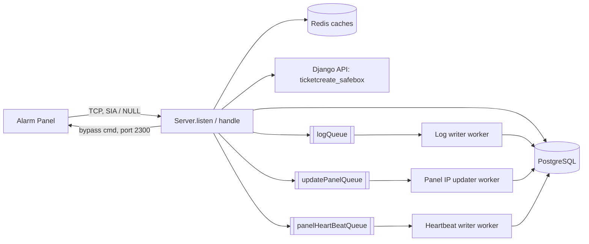
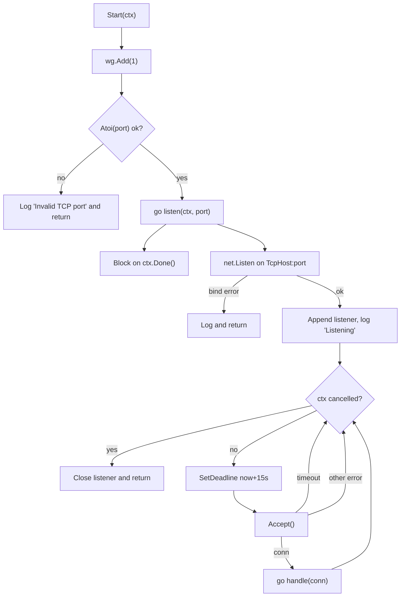
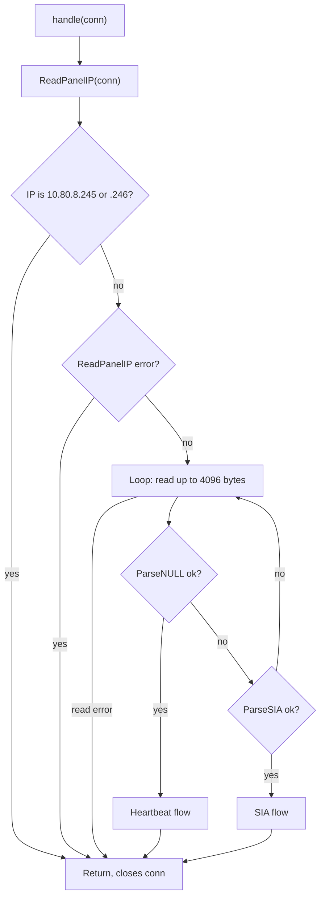
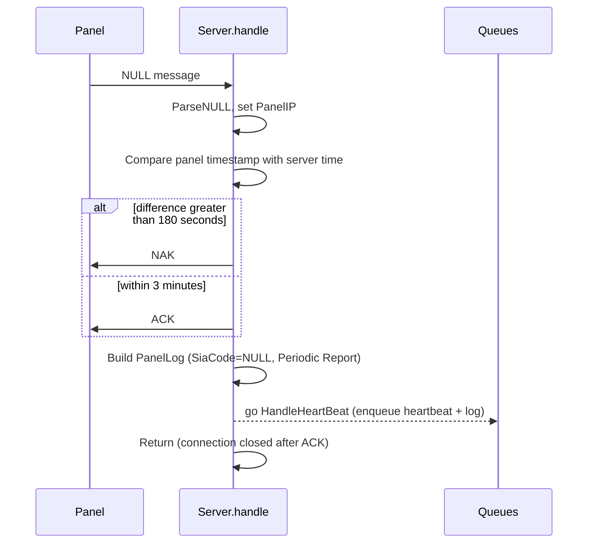
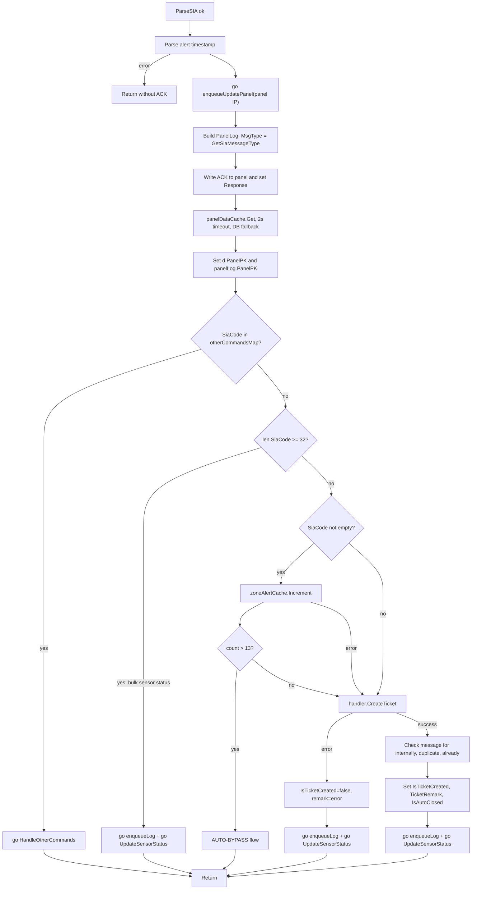
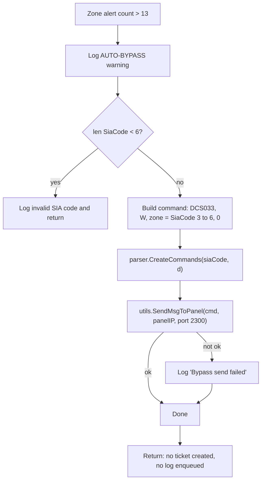
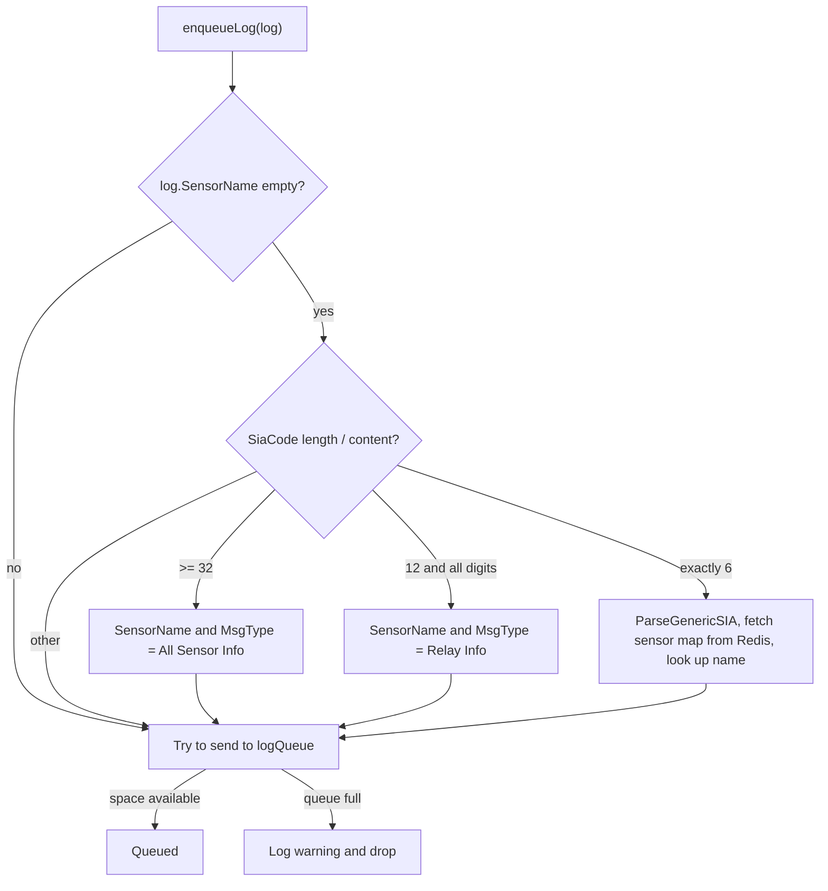
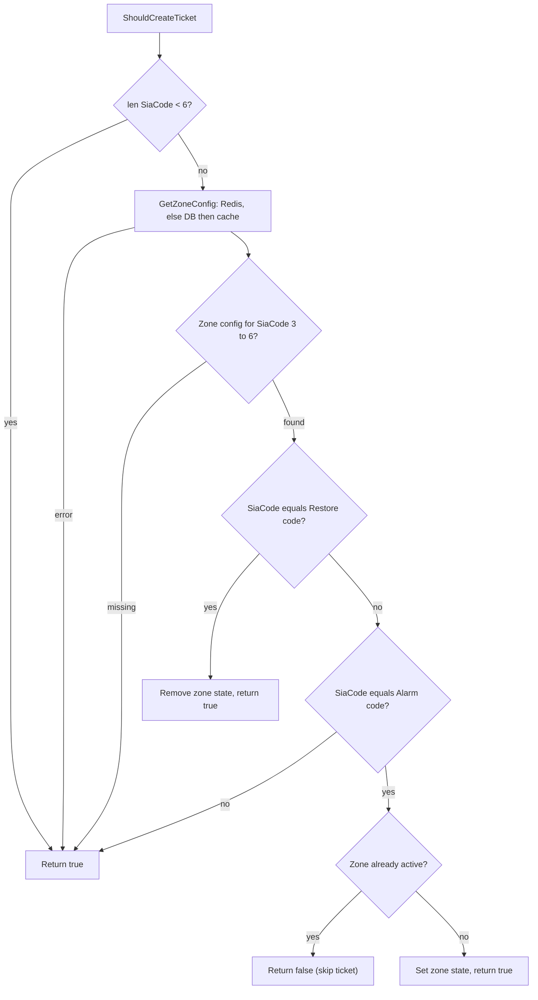

Start the TCP listener.

Accept incoming panel connections.

Start a goroutine for each connection.

Read the incoming bytes.

Parse the message as NULL or SIA.

Send an ACK or NAK when appropriate.

Fetch panel configuration using Redis and PostgreSQL.

Determine the event category.

Apply alert-count and auto-bypass rules.

Create a ticket if the event qualifies.

Queue logs and sensor updates.

Start() — controls the server's startup and lifecycle.

Listen() — opens a TCP port and accepts incoming connections.

Handle() — communicates with each connected client.

Stop() — shuts down the server and releases resources safely.

# TCP Server (`package server`)

Part of the `db-utopia` service. This package is the **network entry point** for alarm/security panels. It listens on a TCP port, accepts connections from panels, parses their messages (**NULL heartbeats** and **SIA alarm events**), replies with an ACK/NAK, and then fans the work out to the handler package, Redis caches, PostgreSQL, the Django ticketing API, and asynchronous queues.

> Companion document: the `handler` package README describes the functions this server calls (`HandleHeartBeat`, `HandleOtherCommands`, `UpdateSensorStatus`, `CreateTicket`, `GetSiaMessageType`, `ParseGenericSIA`).

---

## Table of Contents

1. [Overview](#overview)
2. [Architecture](#architecture)
3. [Server Struct and Dependencies](#server-struct-and-dependencies)
4. [Flow Diagrams](#flow-diagrams)
5. [Function Reference](#function-reference)
6. [Business Rules at a Glance](#business-rules-at-a-glance)
7. [Known Issues and Recommendations](#known-issues-and-recommendations)

---

## Overview

| Responsibility | Where |
|---|---|
| Listen on a TCP port and accept panel connections | `Start`, `listen` |
| Read the panel IP, parse and respond to messages | `handle` |
| Decide whether a SIA code is a "regular" alarm or an "other command" | `otherCommandsMap`, `isExistInOtherCommands` |
| Auto-bypass noisy zones (more than 13 alerts) | inside `handle` |
| Create tickets in Django | `handler.CreateTicket` (called from `handle`) |
| Zone-state de-duplication (currently disabled) | `ShouldCreateTicket`, `GetZoneConfig` |
| Push logs, IP updates and heartbeats to async workers | `enqueueLog`, `enqueueUpdatePanel`, `enqueueHeartBeat` |
| Graceful shutdown | `Stop` |

---

## Architecture

The three queues are Go channels created outside this package and injected through `NewServer`. Workers that drain them live elsewhere. The server only enqueues, and drops the item (with a warning) if a queue is full.

---

## Server Struct and Dependencies

| Field | Type | Purpose |
|---|---|---|
| `cfg` | `*config.Config` | `TcpHost`, `DjangoHost`, etc. |
| `port` | `string` | TCP port to listen on |
| `wg` | `sync.WaitGroup` | Tracks the listener goroutine |
| `pool` | `*pgxpool.Pool` | PostgreSQL connection pool |
| `listeners` | `[]net.Listener` | Open listeners, closed in `Stop` |
| `zoneAlertCache` | `*redis.ZoneAlertCache` | Per panel/client/zone alert counter (used for auto-bypass) |
| `panelZoneDataCache` | `*redis.PanelZoneDataCache` | Cached zone configuration (alarm/restore codes) |
| `panelZoneStateCache` | `*redis.PanelZoneStateCache` | Tracks which zones are currently in alarm |
| `panelSensorCache` | `*redis.PanelSensorCache` | Panel to zone to sensor name map |
| `panelDataCache` | `*redis.PanelDataCache` | Cached panel record (provides `PanelPK`) |
| `logQueue` | `chan models.PanelLog` | Async panel log writes |
| `updatePanelQueue` | `chan models.PanelIPUpdate` | Async panel IP updates |
| `panelHeartBeatQueue` | `chan models.PanelHeartBeat` | Async heartbeat writes |

---

## Flow Diagrams

### 1. Startup and accept loop

### 2. Per-connection flow (`handle`)

### 3. Heartbeat (NULL) flow

### 4. SIA event flow

### 5. Auto-bypass flow

### 6. `enqueueLog` sensor-name enrichment

### 7. `ShouldCreateTicket` (defined but currently not called)

---

## Function Reference

### `NewServer(cfg, port, pool, zoneAlertCache, panelZoneDataCache, panelZoneStateCache, panelSensorCache, panelDataCache, logQueue, updatePanelQueue, panelHeartBeatQueue) *Server`
Constructor that wires all dependencies. The older multi-port variant (`ports []int`) is commented out, so the server now listens on a single port.

### `isExistInOtherCommands(SIACode string) bool`
Exact (trimmed) lookup in `otherCommandsMap`. Codes in this set (keypad logins, hooter events, arm/disarm, expander cards, panic, battery low, environment readings, and so on) are handed to `handler.HandleOtherCommands` instead of going through ticket creation.

### `Start(ctx context.Context)`
Parses the port, launches `listen` in a goroutine, and blocks until the context is cancelled.

### `listen(ctx, port)`
Binds the TCP listener, then loops: sets a 15-second accept deadline so it can regularly check for cancellation, accepts connections, and runs each in its own goroutine via `handle`.

### `handle(conn net.Conn)`
The core of the package. For each connection:
1. Reads the panel IP with `utils.ReadPanelIP`. Two hardcoded IPs (`10.80.8.245`, `10.80.8.246`) are ignored.
2. Reads messages in a loop and tries `ParseNULL`, then `ParseSIA`.
3. **NULL**: sends ACK, or NAK if the panel clock differs from the server by more than 180 seconds, then enqueues the heartbeat and log and closes the connection.
4. **SIA**: acknowledges, resolves `PanelPK` from the Redis panel cache (DB fallback, 2-second timeout), then branches into other commands, bulk sensor status, auto-bypass, or ticket creation (see diagram 4).

### `ShouldCreateTicket(ctx, panelID, clientID, siaCode) (bool, error)`
De-duplicates alarms per zone. A restore code clears the zone state, an alarm code on an already-active zone returns `false`, and anything else returns `true`. Errors and missing config default to `true` (fail open). **Currently unused**: the call site in `handle` is commented out.

### `GetZoneConfig(ctx, panelID, clientID) (map[string]models.ZoneConfig, error)`
Cache-aside loader for zone configuration: Redis first, then `db.LoadZoneConfig`, then writes back to Redis (cache write failures are logged, not fatal).

### `Stop()`
Closes all listeners, closes the DB pool, then waits for the listener goroutine.

### `enqueueLog`, `enqueueUpdatePanel`, `enqueueHeartBeat`
Non-blocking sends to their channels (`select` with `default`). If a queue is full the item is dropped and a warning is logged. `enqueueLog` also fills in `SensorName` and `MsgType` for bulk-status, relay (12-digit), and 6-character codes.

---

## Business Rules at a Glance

| Rule | Value |
|---|---|
| Max read size per message | 4096 bytes |
| Accept deadline (for shutdown checks) | 15 seconds |
| Allowed panel/server clock skew | ±180 seconds, otherwise NAK |
| Panel cache lookup timeout | 2 seconds |
| Bulk sensor status string | SIA code length >= 32 |
| Relay info | 12-digit, all-numeric code |
| Auto-bypass trigger | zone alert count > 13 |
| Auto-bypass command | `DCS033|W|<zone>|0` sent to panel port `2300` |
| Auto-close keywords in ticket response | `internally`, `duplicate`, `already` |
| Ignored panel IPs | `10.80.8.245`, `10.80.8.246` |

---

## Known Issues and Recommendations

Observations from reading the code, worth reviewing:

1. **WaitGroup leak on invalid port.** `Start` calls `wg.Add(1)` before validating the port. If `Atoi` fails, `Done` is never called and `Stop()` will hang on `wg.Wait()`. Move `Add` after validation.
2. **Busy loop after shutdown.** In `listen`, a non-timeout `Accept` error (such as "use of closed network connection" after `Stop()` closes the listener) hits `continue` and spins until the context is cancelled. Return when the error is `net.ErrClosed`.
3. **Unsynchronised `s.listeners`.** The slice is appended in `listen` and read in `Stop` with no mutex.
4. **`Stop()` closes the DB pool before goroutines finish.** `go handler.…` and `go s.enqueueLog` goroutines may still be using the pool. Also, `Start` returns on `ctx.Done()` without waiting for connection handlers, and `wg` tracks only the listener.
5. **Ignored-IP check runs before the error check.** In `handle`, `panelIP` is inspected before checking `err`. It works because the value is empty on error, but swapping the order is clearer. Move the hardcoded IPs and the `2300` port into config.
6. **Connection closes after one SIA message.** Every branch ends in `return`, so the `for` loop only continues for unparseable messages. If persistent connections are expected, this is a bug. If not, the loop is misleading.
7. **No ACK on timestamp parse failure.** A bad timestamp returns immediately with no reply and no log, so the panel may retry.
8. **Auto-bypassed alerts leave no trace.** The logging block after bypass is commented out, so the 14th and later alerts create no ticket and no log entry. Consider logging them.
9. **Zone counter semantics.** The "alerts in 1 hour" behaviour (per the commented-out remark) depends on the TTL set inside `ZoneAlertCache.Increment`. This is not visible here, and the counter is keyed by the full `SiaCode`, which may include the alarm/restore prefix.
10. **Unbounded goroutines.** `go s.enqueueLog(...)`, `go handler.UpdateSensorStatus(...)` and similar spawn a goroutine per message. They run concurrently, so log ordering and sensor-state updates are not guaranteed, and they cannot be cancelled. The `enqueueLog` call already does a non-blocking send, so the `go` is unnecessary for it.
11. **Command-map mismatch with the handler.** `otherCommandsMap` contains `NYY655][N`, `NYY656][N`, `NCL400` and `NOA400`, which are absent from the handler's `otherCommandTypeMap`. For the NYY codes the default branch will log an empty `MsgType`. The `NYY651…`/`NYY652…` keys also contain literal payload fragments, so exact matching will only hit if the panel sends exactly that text.
12. **Cache-key inconsistency in `enqueueLog`.** For 6-character codes it looks up `panelMap[siaCode]` (full code), whereas bulk handling uses the zone number. This likely should be the zone (`ParseGenericSIA` already returns it). The trailing `else {}` is also empty.
13. **`ShouldCreateTicket` is dead code.** Either re-enable it (the "Sensor Already in Alarm" path is commented out in `handle`) or remove it together with `panelZoneStateCache`/`GetZoneConfig`.
14. **Context handling.** Counter increments use `context.Background()` with no timeout, so a slow Redis blocks the connection goroutine. `ctx.Done()` is also not propagated to `handle`.
15. **Raw payload logging.** Every message is logged with `%q` at info level. This is useful for debugging, but may be noisy and may expose panel identifiers in production logs.